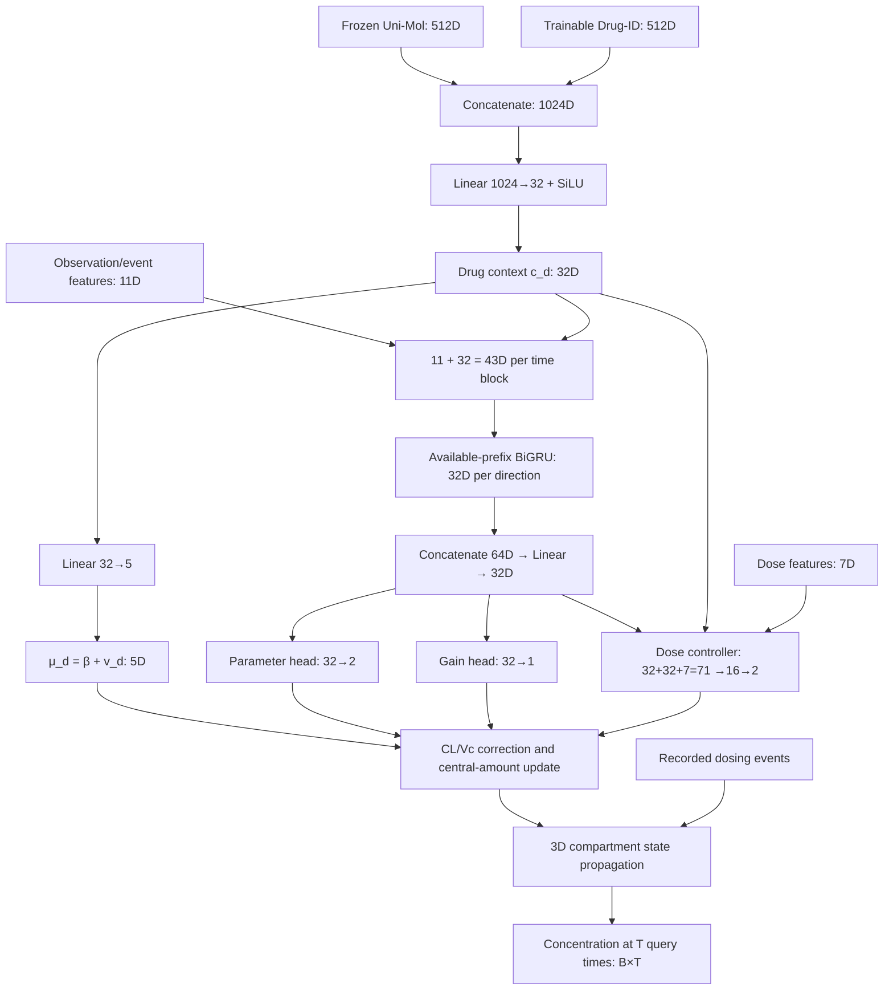

# MoDA-PK 모델 상세 설명

> 대상: 현재 원고의 **11개 약물 FULL 모델**과 원래 matched-ablation 프로토콜.  
> 기준: 현재 저장소의 실행 코드. 작성일: 2026-11-03.  
> 목적: embedding 차원, 실제 계산 순서, 관측 업데이트, 학습·평가 조건을 하나의 문서에서 설명한다.

## 1. 모델이 해결하려는 문제

MoDA-PK는 약물의 분자 표현, 약물 식별자, 개인에게 투여된 기록, 지금까지 제공된 농도 관측을 이용하여 **그 이후의 농도**를 예측한다.

정보는 세 수준으로 나뉜다.

- **약물 수준:** 분자 embedding과 Drug-ID로 약물별 effective PK prior를 만든다.
- **개인 관측 수준:** 같은 약물을 받더라도 다른 농도 이력을 보이는 개인을 관측 기반 업데이트로 구별한다.
- **시간·투여 수준:** compartment dynamics와 투여 이벤트로 불규칙한 시간의 농도를 계산한다.

모델은 모든 미래 농도를 신경망으로 바로 출력하는 구조가 아니다. 신경망은 **약물별 prior, CL/Vc correction, central-amount gain**을 출력하고, 최종 농도는 compartment 상태에서 계산한다.

현재 모델은 체중·나이·성별을 직접 입력하지 않는다. Drug-ID는 환자 ID가 아니라 **약물 ID**이다. 따라서 관측이 없으면 같은 약물·같은 투여 기록을 가진 두 개인은 기본적으로 같은 예측을 받는다.

## 2. 기호와 주요 텐서

| 기호 | 의미 | 대표 크기 |
|---|---|---|
| B | batch 내 drug–occasion 프로파일 수 | — |
| D | 훈련에 포함된 약물 수 | 통합 모델에서 11 |
| E | 프로파일별 투여 이벤트 수의 batch 최대값 | — |
| S | 제공 관측 레코드 수의 batch 최대값 | — |
| k | 제공하는 distinct observation time block 수 | 주 평가에서 3 |
| T | 미래 query 시점 수의 batch 최대값 | — |
| z_d | frozen Uni-Mol 표현 | B × 512 |
| e_d | 학습 가능한 Drug-ID 표현 | B × 512 |
| c_d | joint drug context | B × 32 |
| μ_d | drug-conditioned log-PK prior | B × 5 |
| f_i | 관측·이벤트 특성 | B × 11 |
| x_i | BiGRU 입력 | B × 43 |
| h_i | projected bidirectional history summary | B × 32 |
| A_i | depot/central/peripheral amount | B × 3 |
| θ_i | 관측으로 보정한 log-PK 파라미터 | B × 5 |
| ŷ | 미래 log-concentration 예측 | B × T |

B는 환자 수가 아니라 **프로파일 수**이다. 한 참가자가 여러 프로파일을 가질 수 있다. k도 관측 레코드 수와 같지 않을 수 있다. 동일 시점 replicate는 하나의 time block으로 취급한다.

배치 안에서 길이가 다른 관측과 query는 padding하고 mask로 유효 레코드를 구별한다. 주로 사용하는 신경망 계산 dtype은 `torch.float64`이다.

## 3. 전체 차원 흐름



Drug context 32D는 prior 생성에만 쓰이는 것이 아니다. 관측 encoder와 dose controller에도 공유된다. 반면 Drug-ID 512D를 매 시점의 BiGRU에 직접 넣지는 않는다. 먼저 joint projection으로 압축한 32D를 넣는다.

## 4. 분자 표현과 Drug-ID conditioning

### 4.1 Frozen Uni-Mol: 512D

약물 d에 대해 사전 계산된 Uni-Mol embedding `z_d ∈ R^512`를 읽는다. PK 학습 중 Uni-Mol encoder를 fine-tuning하지 않는다. 실제 PK optimizer가 업데이트하는 대상에 대형 Uni-Mol backbone은 포함되지 않는다.

분자 표현은 훈련에 포함된 약물들만으로 표준화한다.

\[
\widetilde z_{d,j}=\frac{z_{d,j}-m_j}{\max(\sigma_j,0.1)}.
\]

여기서 평균과 표준편차는 **환자 행의 반복 수가 아닌 훈련 약물별 embedding**으로 계산한다. 환자가 많은 약물이 표준화 통계를 중복 지배하지 않도록 한 구조이다.

단일약물 모델에서는 표준화에 쓰이는 분자가 하나이므로 그 약물의 표준화된 분자 벡터가 0이 된다. 따라서 단일약물 성능 자체를 분자 정보의 기여로 해석하면 안 된다.

### 4.2 Trainable Drug-ID: 512D

통합 모델은 다음 lookup table을 가진다.

\[
E_{\mathrm{ID}}\in\mathbb R^{11\times512}.
\]

각 프로파일의 약물 정수 index로 한 행을 읽는다. 같은 약물의 모든 프로파일은 같은 ID embedding을 공유한다. ID mapping은 훈련 약물 집합으로 구성한다.

이 표현은 분자 구조에서 계산한 값이 아니라, 훈련 농도 자료를 통해 학습한 약물별 latent vector이다. 코드에는 unknown ID `-1`에 대해 훈련 ID embedding의 평균을 사용하는 fallback도 있지만, 이는 현재 seen-drug 평가에서 새 약물 성능을 검증했다는 의미는 아니다.

### 4.3 Joint context: 1024D → 32D

\[
u_d=[\widetilde z_d;e_d]\in\mathbb R^{1024},
\qquad
c_d=\operatorname{SiLU}(W_c u_d+b_c)\in\mathbb R^{32}.
\]

- `W_c`: 32 × 1024
- `b_c`: 32
- projection 파라미터 수: **32,800**

FULL에서는 두 입력을 모두 사용한다. ID-ONLY는 `[0; e_d]`, MOL-ONLY는 `[z_d; 0]`이다. Ablation에서도 1024D 입력과 projection 형태를 유지한다.

## 5. Drug-conditioned PK prior: 32D → 5D

\[
v_d=W_vc_d+b_v\in\mathbb R^5,
\qquad
\mu_d=\beta+v_d.
\]

순서는 다음과 같다.

\[
\mu_d=(\log k_a,\log CL,\log V_c,\log Q,\log V_p).
\]

| 파라미터 | 역할 | 표준화 단위 기준 |
|---|---|---|
| k_a | depot에서 central로의 흡수 속도상수 | h⁻¹ |
| CL | central elimination clearance | L/h |
| V_c | central volume | L |
| Q | intercompartmental clearance | L/h |
| V_p | peripheral volume | L |

β는 훈련 자료로 수행한 population initialization으로 초기화하는 5D base이다. 신경망 학습 중에는 **학습 가능한 파라미터**이다. v_d는 context에서 나온 5D residual이며, residual head는 0으로 초기화한다.

즉, μ_d는 처음부터 고정된 문헌 파라미터를 뜻하지 않는다. β와 drug-conditioned residual이 PK 예측 목적에 맞게 학습된다. 양수 파라미터는 log 값을 exponentiation하여 얻는다.

`32D drug context`와 `5D PK prior`는 구분해야 한다. 전자는 latent 표현이고, 후자는 compartment dynamics에 직접 들어가는 effective PK 파라미터이다.

## 6. 세 compartment와 투여 이벤트

상태의 순서는 다음과 같다.

\[
A(t)=(A_g(t),A_c(t),A_p(t))^\top\in\mathbb R^3.
\]

- A_g: depot amount
- A_c: central amount
- A_p: peripheral amount

투여가 없는 구간의 기본식은 다음과 같다.

\[
\frac{dA_g}{dt}=-k_a A_g,
\]

\[
\frac{dA_c}{dt}=k_a A_g-
\left(\frac{CL}{V_c}+\frac{Q}{V_c}\right)A_c+
\frac{Q}{V_p}A_p,
\]

\[
\frac{dA_p}{dt}=\frac{Q}{V_c}A_c-\frac{Q}{V_p}A_p.
\]

투여 이벤트는 `B × E × 4` 텐서로 전달한다.

```text
[event_start_time, dose_amount, route_code, infusion_duration]
```

| Route code | 투여 방식 | 상태에 대한 입력 |
|---:|---|---|
| 0 | Oral | depot amount에 impulse |
| 1 | IV bolus | central amount에 impulse |
| 2 | IV infusion | 지정 구간 동안 central에 일정 rate |

시간은 h, amount는 μmol, 농도는 μmol/L로 정리한다. Infusion rate는 amount/duration이다.

현재 solver는 이 선형 compartment 계의 **analytic transition과 infusion response**를 사용한다. 신경망이 임의의 derivative를 출력하는 neural ODE 구조가 아니다. 관측 경계를 가로지르는 infusion은 경계 이후 남은 구간만 전달하며, 경계 투여를 중복 반영하지 않도록 `include_start`를 관리한다.

## 7. 관측 직전 상태와 농도 계산

관측 시점 t_i에 도달하기 전, 이전 보정 상태를 기존 파라미터로 전파한다.

\[
A_i^-=\operatorname{Advance}
(\theta_{i-1},A_{i-1}^+,t_{i-1},t_i,\mathcal D).
\]

관측 직전 예측 log 농도는 다음과 같다.

\[
\widehat y_i^-=\log\max\left(\frac{A_{c,i}^-}{V_{c,i-1}},10^{-5}\right).
\]

**현재 모델의 실제 농도 link는 `relational.floor_concentration`이다.** 저장소의 다른 `concentration` helper 중에는 `log(C+ε)` 형태도 있으므로, 함수 이름만 보고 혼동하면 안 된다. 현재 FULL 경로는 `log(max(C, 1e-5))`를 사용한다.

동일 시점 replicate가 있으면 코드는 그 시점의 **log 농도 평균**을 관측 y_i로 사용한다. 따라서 amount 보정에 쓰이는 `exp(y_i)`는 replicate 농도의 기하평균에 해당하며, arithmetic mean으로 바꾸지 않는다.

## 8. 관측·이벤트 특성 11D

관측 시점마다 다음 순서의 벡터를 구성한다.

| Index | 특성 | 처리 |
|---:|---|---|
| 0 | 실제 제공된 log 농도 y_i | log 농도 |
| 1 | 관측 직전 예측 log 농도 | compartment state에서 계산 |
| 2 | innovation | y_i − 예측 log 농도 |
| 3 | 직전 처리 시점 이후 경과시간 | log1p |
| 4 | 최근 시작한 투여 이벤트 이후 시간 | log1p |
| 5 | 현재까지 전달된 누적 dose amount | log1p |
| 6 | 현재 활성 infusion rate | log1p |
| 7 | 현재 시점 replicate 수 | log1p |
| 8 | 과거·현재 oral 이벤트 존재 | boolean → 수치 |
| 9 | 과거·현재 IV bolus 이벤트 존재 | boolean → 수치 |
| 10 | 과거·현재 IV infusion 이벤트 존재 | boolean → 수치 |

Infusion의 누적 전달량은 duration에 따른 진행 비율로 계산한다. Route flag는 최근 투여 하나의 one-hot만이 아니라, 해당 시점까지 그 유형의 투여가 있었는지를 표시하므로 mixed regimen에서는 여러 flag가 켜질 수 있다.

Drug context를 연결하면 encoder 입력은 다음과 같다.

\[
x_i=[f_i;c_d]\in\mathbb R^{11+32}=\mathbb R^{43}.
\]

FULL의 `dose_gate` 경로에서는 11D feature 자체에 FiLM 변환을 하지 않는다. 저장소에 존재하는 `dose_film` 대안과 현재 FULL 모델을 혼동하면 안 된다.

## 9. Available-prefix BiGRU: 43D → 64D → 32D

각 방향은 `GRUCell(input_size=43, hidden_size=32)`이다.

관측 i의 업데이트를 계산할 때 실제로 사용하는 sequence는 다음뿐이다.

\[
X_{1:i}=(x_1,\ldots,x_i).
\]

- 정방향 GRU: x₁ → … → xᵢ
- 역방향 GRU: xᵢ → … → x₁
- 방향별 terminal summary: 각각 32D
- 연결: 64D
- Linear projection: 64 → 32

\[
h_i=W_h[h_i^{\rightarrow};h_i^{\leftarrow}]+b_h.
\]

이 projection 뒤에는 코드상 별도의 activation이 없다. 양방향 계산은 각 관측 prefix에 대해 수행하므로, 역방향 GRU가 관측 i 이후의 농도를 읽는 것은 아니다.

또한 각 token의 innovation과 예측 농도는 그 시점까지 전파된 state로 계산한다. 나중에 받은 농도로 과거 token을 다시 만들어 이전 업데이트를 바꾸는 방식이 아니다. Padding된 관측은 active mask로 제외하며, forward 호출마다 token history를 reset한다.

주 평가가 k=3이면 개념적으로 prefix 길이 1, 2, 3의 업데이트가 순서대로 발생한다. Replicate 레코드는 time block 단위로 묶여 한 번만 상태를 갱신한다.

## 10. Dose controller: 71D → 16D → 2D

관측 이력의 요약만으로 보정 강도를 결정하지 않고, 약물 context와 투여 관련 특성을 함께 사용한다.

\[
u_i^{\mathrm{gate}}=[h_i;c_d;f_i^{\mathrm{dose}}]
\in\mathbb R^{32+32+7}=\mathbb R^{71}.
\]

7D dose feature의 index는 `[3,4,5,6,8,9,10]`이다. 즉, 시간 관련 두 항목, 전달량, 활성 rate, route flag 세 개이다. Replicate count는 이 7D에 포함하지 않는다.

\[
(a_i,b_i)=W_2\operatorname{SiLU}(W_1u_i^{\mathrm{gate}}+b_1)+b_2,
\]

네트워크 크기는 `Linear(71,16) → SiLU → Linear(16,2)`이다.

- a_i: CL/Vc correction logit의 scale을 조정
- b_i: amount-gain logit에 가산

마지막 Linear는 0으로 초기화한다. 따라서 초기 a_i=b_i=0이며, 아래 parameter scale은 1, gain에 대한 추가 logit shift는 0이다. 투여 경로별 별도 expert 네트워크를 선택하는 구조는 아니다.

## 11. CL/Vc parameter correction: 32D → 2D

먼저 history summary에서 두 correction logit을 계산한다.

\[
r_i=W_\delta h_i+b_\delta\in\mathbb R^2.
\]

Dose controller의 첫 출력으로 bounded scale을 만든다.

\[
s_i=2\sigma(a_i)\in(0,2).
\]

최종 correction은 다음과 같다.

\[
\delta_i=2\tanh(s_i r_i)\in(-2,2)^2.
\]

새 log-PK 파라미터는 다음과 같다.

\[
\theta_i=\mu_d+
(0,\delta_{i,CL},\delta_{i,V_c},0,0)^\top.
\]

중요한 특징은 **이전 correction에 누적하지 않고 drug prior를 기준으로 다시 보정**한다는 점이다. 즉 `θ_i = θ_{i−1} + δ_i`가 아니다.

- CL과 Vc만 관측 기반으로 보정한다.
- ka, Q, Vp는 해당 프로파일에서 drug prior 값을 유지한다.
- CL과 Vc는 prior 대비 각각 약 exp(−2)~exp(2) 범위의 multiplicative correction을 받는다.
- Parameter head는 `Linear(32,2)`이며 0으로 초기화한다.

Bound와 positivity는 유효한 수치 범위를 돕지만, 이 값이 개인의 참 생리학적 파라미터라는 것을 입증하지는 않는다.

## 12. Central-amount adaptation: 32D → 1D

History summary로부터 scalar logit을 만들고 dose-controller shift를 더한다.

\[
g_i=\sigma(W_g h_i+b_g+b_i)\in(0,1).
\]

그다음 **새 parameter correction을 반영한 Vc**로 관측 농도를 amount에 대응시킨다.

\[
C_i=\exp(y_i),\qquad
V_{c,i}=\exp(\theta_{i,V_c}),
\]

\[
A_{c,i}^{+}=(1-g_i)A_{c,i}^{-}+g_iC_iV_{c,i}.
\]

Depot와 peripheral amount는 관측 직전 전파 값을 유지한다.

\[
A_i^+=(A_{g,i}^-,A_{c,i}^+,A_{p,i}^-).
\]

여기서 g_i는 예측 상태와 관측으로부터 계산한 central amount를 섞는 학습된 gain이다. 확률로 보정된 불확실성이나 posterior variance를 의미하지 않는다.

이 업데이트는 **숨겨진 amount의 추정 보정**이다. 관측 농도를 새 dose로 투입한다는 의미도 아니고, 생리학적인 mass conservation을 관측 동화 단계 전체에서 검증했다는 의미도 아니다. 관측 사이 전파는 compartment dynamics를 따른다.

Gain head도 `Linear(32,1)`을 0으로 초기화하므로, 초기 gain은 특별한 비활성화가 없는 경우 0.5이다. 최초 시점 업데이트를 허용하는 FULL의 기본 설정을 유지한다.

## 13. 한 관측 시점에서의 실제 순서

```text
입력: 이전 보정 상태 A⁺, 이전 파라미터 θ, 시점까지의 관측, 투여 이벤트

1. 이전 θ와 dose events로 현재 시점까지 state 전파 → A⁻
2. A⁻ / 이전 Vc로 현재 관측 직전 농도 예측
3. 실제 제공 농도와의 innovation 등 11D feature 구성
4. 11D + drug context 32D → 43D token
5. 현재까지의 token prefix를 BiGRU로 처리 → h_i 32D
6. [h_i 32D; context 32D; dose features 7D] → gate control 2D
7. h_i → CL/Vc correction 2D; gate scale을 적용 → 새 θ_i
8. h_i → gain logit 1D; gate shift를 적용 → g_i
9. 새 Vc로 관측 농도 C_i를 amount에 대응 → C_i × 새 Vc
10. central amount만 convex update → A⁺
11. 현재 시점, 새 θ_i, 새 state를 다음 관측으로 전달
```

이 순서에서 **관측 직전 예측은 이전 Vc**, **관측 동화의 amount 변환은 새 Vc**를 쓴다는 차이가 중요하다. Amount 업데이트 뒤에 파라미터를 바꾸는 순서로 재배치하면 현재 모델과 달라진다.

## 14. 마지막 관측 이후의 미래 예측

마지막 제공 관측 이후에는 새로운 농도 관측을 읽지 않는다. 최종 θ와 state를 고정 출발점으로 하여 recorded future dosing events에 따라 각 query로 전파한다.

\[
\widehat A(t)=\operatorname{Advance}
(\theta_k,A_k^+,t_k,t,\mathcal D),\qquad t>t_k,
\]

\[
\widehat C(t)=\frac{\widehat A_c(t)}{\exp(\theta_{k,V_c})},
\qquad
\widehat y(t)=\log\max(\widehat C(t),10^{-5}).
\]

출력은 `B × T`이며, 각 query의 농도이다. Query 예측을 다음 query의 관측처럼 encoder에 다시 넣지 않는다. 실제 미래 농도는 loss와 평가 계산에만 사용한다.

k=0이면 관측 기반 보정 없이 약물 prior와 투여 기록으로 예측한다. 미래 dose가 입력으로 허용된 실험이므로, 미래 투여 계획까지 자동으로 예측하는 모델이라고 해석하면 안 된다.

## 15. 학습 loss와 원래 평가 프로토콜

### 15.1 Hierarchical weighted log-MSE

\[
\mathcal L_{\mathrm{data}}=
\sum_{s,d,p,q}w_{sdpq}(\widehat y_q-y_q)^2,
\]

\[
w_{sdpq}=\frac{1}{|S|\,|D_s|\,|P_{sd}|\,|Q_{sdp}|}.
\]

여기서 참가자의 Q는 여러 프로파일에 걸친 query 레코드를 합친 것이다. Source별 균형 → source 내부 drug별 균형 → drug 내부 participant별 균형을 적용한다. Source마다 drug 수가 다르면 equal-drug macro weighting과는 다르다.

\[
\mathcal L=\mathcal L_{\mathrm{data}}+10^{-3}R_\delta+10^{-4}R_v.
\]

- R_delta: 제공 관측의 CL/Vc correction 제곱 평균을 profile/query 가중치로 집계
- R_v: 5D drug-prior residual의 제곱 평균을 같은 방식으로 집계
- 별도 amount-gain regularization term은 원래 objective에 없다.

### 15.2 현재 원고와 matched ablation의 조건

| 항목 | 설정 |
|---|---|
| 데이터 | 11 drugs, 482 profiles, 342 source-scoped participants |
| Train/validation/test profiles | 285 / 96 / 101 |
| Train/validation/test participants | 202 / 67 / 73 |
| 원래 optimizer | AdamW, lr 0.003, weight decay 0.0001 |
| Gradient clip | 5 |
| 원래 학습 | Full-batch, 120 optimizer updates |
| Validation | 10 updates마다, epoch 0 포함, 최저 validation SB-hRMSE 선택 |
| 학습 history | k ∈ {0,1,2,4} |
| 학습·검증 query | 네 번째 observation block 이후 |
| 검증 history | k=2 |
| Primary test | k=3, 세 번째 block 이후의 모든 평가 관측 |
| 현재 필수 ablation seeds | 1,2,3,4,5 |

배치 loader의 episode slot index `[0,1,2,3]`는 실제 관측 수 `[0,1,2,4]`에 대응한다. **Slot 3이 k=3을 뜻하지 않는다.** Primary test의 k=3 episode는 별도로 구성한다.

Train/validation/test의 예측창 차이는 현재 비교에서 모든 variant에 동일하게 유지한 원래 한계이다. 그 사실 자체가 미래 농도 누출을 뜻하지는 않지만, 완전히 정렬된 임상 예측 실험이라고 볼 수도 없다.

과거 별도 수행한 mini-batch·장기학습 실험은 이 원고의 matched-ablation 조건과 혼합하지 않는다.

### 15.3 평가 지표

참가자별 query log-MSE를 먼저 평균하고, 그 평균을 약물 내부 참가자 사이에서 평균한 뒤 제곱근을 취한다.

\[
M_{sdp}=\frac1{|Q_{sdp}|}\sum_q(\widehat y_q-y_q)^2,
\qquad
R_{sd}=\sqrt{\frac1{|P_{sd}|}\sum_pM_{sdp}}.
\]

\[
\mathrm{SB\text{-}hRMSE}
=\frac1{|S|}\sum_s\frac1{|D_s|}\sum_dR_{sd}.
\]

5-seed mean ± sample SD는 학습 반복의 변동을 나타내며, 환자 모집단에 대한 95% confidence interval이 아니다.

## 16. 현재 ablation과 모델 flow의 연결

| Variant | Molecular 512D | Drug-ID 512D | CL/Vc correction | Amount correction |
|---|---|---|---|---|
| FULL | 사용 | 사용 | 사용 | 사용 |
| NO-UPDATE | 사용 | 사용 | 0 | gain 0 |
| PARAM-ONLY | 사용 | 사용 | 사용 | gain 0 |
| AMOUNT-ONLY | 사용 | 사용 | 0 | 사용 |
| ID-ONLY | 0 vector | 사용 | 사용 | 사용 |
| MOL-ONLY | 사용 | 0 vector | 사용 | 사용 |

- CL/Vc correction을 끄면 매 관측 시점의 θ는 μ_d이다. 이전 보정이 남지 않는다.
- Amount correction을 끄면 central amount는 관측 전 전파 값을 유지한다.
- NO-UPDATE는 관측 농도값을 바꿔도 예측이 바뀌지 않아야 한다. 이 불변성은 실제 테스트로 확인했다.
- Disabled parameter correction의 penalty는 0이다. Prior residual penalty는 유지한다.
- Conditioning 입력을 제거해도 projection 크기는 1024→32이다. 제거된 입력에 연결된 가중치의 effective usage는 달라진다.
- 각 ablation은 별도로 처음부터 훈련한다. 학습 완료한 FULL의 head를 추론 중 끈 값을 주 결과로 사용하지 않는다.
- FULL은 기존 seed 1~5 checkpoint를 재사용하고, 나머지 5개 variant는 각각 5회 학습했다. 최초 15회에 추가 10회를 수행한 총 25회이다.

5-seed overall 결과:

| Variant | SB-hRMSE, mean ± sample SD |
|---|---:|
| FULL | 0.467 ± 0.011 |
| NO-UPDATE | 0.562 ± 0.055 |
| PARAM-ONLY | 0.572 ± 0.050 |
| AMOUNT-ONLY | 0.508 ± 0.013 |
| ID-ONLY | 0.520 ± 0.006 |
| MOL-ONLY | 0.509 ± 0.017 |

이 결과는 현재 represented-drug 조건에서 결합 업데이트와 두 conditioning 입력의 추가 가치를 지지한다. 다만 모든 약물에서 같은 이득이 있다는 의미는 아니며, 신약 일반화나 생리학적 파라미터 recovery를 검증한 결과도 아니다.

## 17. 실제 학습 파라미터 수

`build_final('full', 11, population)`으로 생성한 현재 11-drug FULL의 파라미터 수는 다음과 같다. Frozen Uni-Mol encoder와 embedding cache 자체는 포함하지 않는다.

| 모듈 | 산출 | 파라미터 수 |
|---|---|---:|
| Drug-ID lookup | 11 × 512 | 5,632 |
| Context projection | 1024 × 32 + 32 | 32,800 |
| Prior residual head | 32 × 5 + 5 | 165 |
| Trainable base β | 5 | 5 |
| **Prior 소계** | 위 네 항목 | **38,602** |
| Forward GRUCell | 3×32×43 + 3×32×32 + 2×3×32 | 7,392 |
| Backward GRUCell | 위와 동일 | 7,392 |
| Bidirectional projection | 64 × 32 + 32 | 2,080 |
| **History encoder 소계** | 위 세 항목 | **16,864** |
| Parameter head | 32 × 2 + 2 | 66 |
| Gain head | 32 × 1 + 1 | 33 |
| Dose controller | (71×16+16) + (16×2+2) | 1,186 |
| **총합** | | **56,751** |

Drug 수 D가 달라지면 ID lookup 크기가 변한다. 같은 구조에서 D=12이면 512개가 늘어난 57,263개이다. 논문·다른 버전에서 약 57k라는 값이 나와도 약물 수 조건을 먼저 확인해야 한다.

이 모델은 1024D joint input을 사용하지만 대부분의 recurrent 계산은 32D hidden에서 이루어진다. 전체 parameter 중 context projection과 Drug-ID table의 비중이 크다. Embedding 크기가 크다는 사실만으로 분자 관련 기여나 일반화가 보장되지는 않는다.

## 18. 코드 위치와 읽는 순서

아래 경로는 저장소 루트 `/workspace/volume/PK_paper` 기준이다.

| 순서 | 파일 | 확인할 내용 |
|---:|---|---|
| 1 | `src/mhap_pk/models/adapters/final_gated_bigru.py` | FULL 및 ablation variant 조립 |
| 2 | `src/mhap_pk/models/priors/molecular_identity.py` | 512+512→32→5 prior |
| 3 | `src/mhap_pk/models/adapters/bidirectional_observer.py` | prefix 양방향 32+32→32 |
| 4 | `src/mhap_pk/models/adapters/dosing_conditioning.py` | 71→16→2 controller와 두 head 결합 |
| 5 | `src/mhap_pk/relational_model.py` | 관측별 전파·feature·parameter·amount 순서 |
| 6 | `src/mhap_pk/relational.py` | 현재 floor-log 농도 link |
| 7 | `src/mhap_pk/state_ode.py` | analytic transition, impulse 및 infusion 처리 |
| 8 | `src/mhap_pk/data/core.py` | embedding scaling, episode slot, tensor와 loss weight |
| 9 | `src/mhap_pk/data/traceable.py` | 원본 11-drug cohort 및 고정 split |
| 10 | `src/mhap_pk/training/traceable_panel.py` | 원래 학습 loop와 loss |
| 11 | `results/essential_ablation_5seed/` | 현재 5-seed ablation 확장, 결과 및 무결성 기록 |

## 19. 설명할 때 지켜야 할 해석 범위

1. **Drug context와 patient context를 구별한다.** 현재 32D는 분자+약물 ID context이며, 환자 demographics embedding이 아니다.
2. **Embedding과 PK parameter를 구별한다.** 512/1024/32D는 latent representation, 5D는 effective log-PK parameter이다.
3. **Parameter correction과 amount correction을 구별한다.** 전자는 이후 dynamics를, 후자는 현재 hidden state의 central amount를 바꾼다.
4. **세 compartment를 모두 개인별 업데이트한다고 설명하지 않는다.** 파라미터는 CL/Vc, state는 central amount만 관측으로 보정한다.
5. **Bidirectional과 미래 누출을 동일시하지 않는다.** 사용 가능한 prefix 안에서 양방향 처리하며 미래 query 농도는 입력하지 않는다.
6. **Seen drug의 새 환자와 unseen drug을 구별한다.** 현재 핵심 결과는 전자의 내부 평가이다.
7. **파라미터 positivity와 physiological validity를 구별한다.** exp와 bounded correction은 수치적 구조이며 개인의 생리 파라미터가 식별됐다는 증거가 아니다.
8. **통합 예측 정확도와 donor 데이터의 이득을 구별한다.** 동일 target low-data 대조에서는 개선 5개·악화 6개로, 일관된 data-efficiency 향상은 확인되지 않았다.
