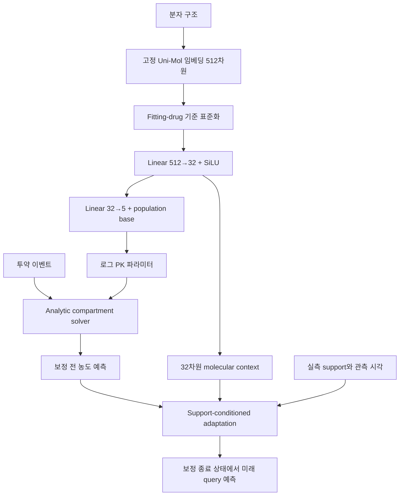
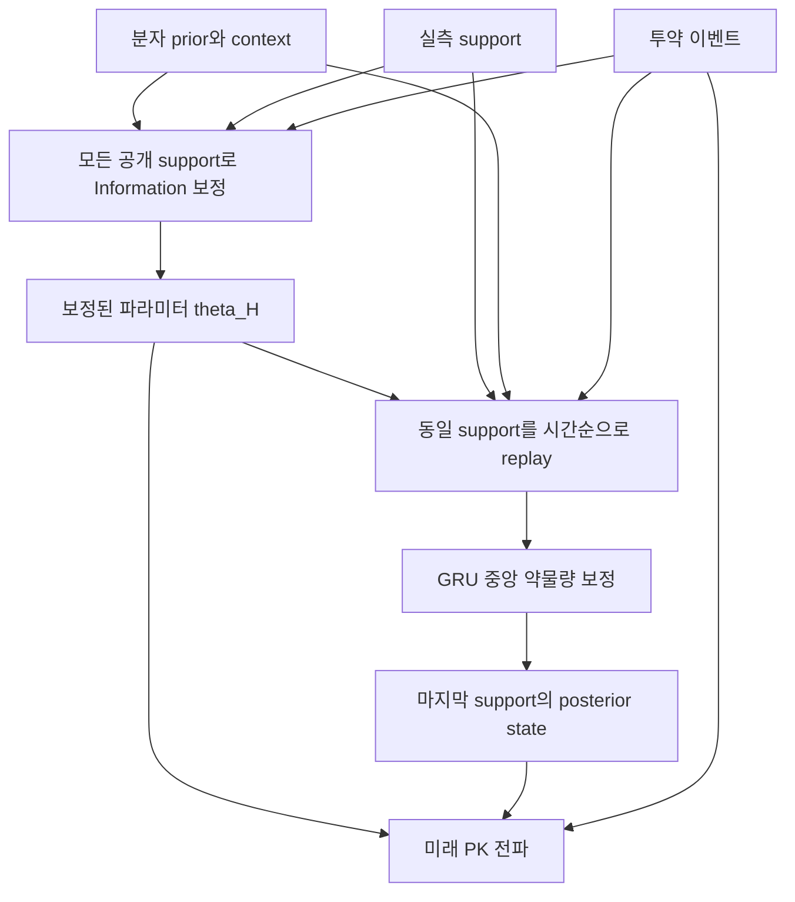

# MHAP-PK 모델 구조 상세 설명

작성·코드 확인일: **2026-09-23**  
범위: 현재 실행 코드, 최근 공통 prior 실험, 다음 구조 변경 제안  
상태: **기존 구조와 개발 후보를 구별하는 기술 문서. 최종 모델 동결 또는 SOTA 선언이 아님.**

후속 업데이트: 첫 support 상태를 이용한 공동 추정 prototype과 세 encoder의 내부 pilot이 구현되었다. 새 구현의 정확한 수식·설정·검증 범위는 [공동 추정 명세](JOINT_ESTIMATION_KO.md)를 우선한다. 아래의 기존 Sequential/직렬 결합 설명은 그대로 유효하다.

## 1. 이 문서에서 말하는 ‘우리 모델’

MHAP-PK의 공통 아이디어는 **분자 구조가 주는 약물 수준 prior, 명시적 투약 이벤트가 구동하는 PK dynamics, 개인의 과거 실측 농도가 주는 보정 정보를 결합해 미래 농도를 예측하는 것**이다.

현재 저장소에는 서로 다른 학습 조건과 구조가 공존한다. 아래 조건을 같은 모델이나 같은 학습 결과로 취급하지 않는다.

| 이름 | 구현/실험 상태 | 핵심 차이 |
|---|---|---|
| 기존 Sequential | 구현·기존 실험 존재 | Molecular prior와 GRU를 해당 학습 절차에서 학습. GRU가 CL·Vc와 중앙 약물량 상태를 보정 |
| 공통 prior-only | 구현·최근 실험 완료 | 따로 학습한 동일 prior를 이용하며 support에 따른 개인 보정 없음 |
| 공통 prior + Information | 구현·최근 실험 완료 | Support의 파라미터 민감도로 로그 PK 파라미터를 한 번 보정 |
| 공통 prior + state observer | 구현·최근 실험 완료 | Prior를 고정하고 GRU의 파라미터 보정 없이 중앙 약물량만 보정 |
| Information + state | 구현·최근 실험 완료 | Information 파라미터 보정 후 같은 support를 state observer로 replay |
| 보정 강도 재선택 후보 | 구현·최근 실험 완료 | 위 구조를 유지하고 내부 Known/shift validation으로 Information 강도를 선택 |
| 공동 파라미터–상태 추정 | **후속 prototype 구현·내부 pilot 완료** | 첫 support 상태와 CL·Vc를 함께 추정. 최종 outer 검증 전이며 새 명세 참조 |

기존 output/dynamics fusion 및 hard routing은 별도의 보존된 연구 조건이다. **최근 `InformationStatePK`는 독립적으로 학습한 두 전문가의 예측을 가중 평균하는 gate 모델이 아니다.**

원고 native Sequential의 기존 점수와 최근 frozen shared-prior 점수는 학습 방식이 다르다. 이번 개발 결과를 기존 논문 표의 같은 행에 덮어쓰지 않는다.

## 2. 예측 문제와 사용 가능한 입력

하나의 episode는 약물 구조, 해당 profile의 투약 기록, 공개된 support, 미래 query 시각으로 구성된다.

$$
\hat C(t_q)=F\bigl(m,D,H,t_q\bigr),\qquad
H=\{(t_i,C_i)\}_{i=1}^{k\text{ time blocks}}.
$$

| 정보 | 실제 모델 입력/사용 위치 | 현재 조건 |
|---|---|---|
| 분자 구조 | 고정 Uni-Mol 임베딩 → prior와 GRU context | 학습 중 encoder를 갱신하지 않음 |
| 투약량·시각 | Compartment state 전파와 GRU 특징 | 단위 변환된 이벤트 사용 |
| 경구/IV bolus/IV infusion | 투약의 유입 구획과 시간 처리 | Infusion duration 포함 |
| 과거 실측 농도·관측 시각 | Information residual 및 GRU observer | 공개된 support만 사용 |
| 미래 query 시각 | 보정 종료 후 PK solver 호출 | Query 농도는 forward 입력이 아님 |
| 미래 실제 농도 | Training loss 또는 validation/test 평가 | 추론 입력으로 제공하지 않음 |
| Drug/source/participant ID | 분할·조회·집계·provenance | 최근 Uni-Mol 조건의 학습된 identity 입력이 아님 |
| 단백질 표적·유전형·추가 환자 공변량 | 현재 입력하지 않음 | 연령·체중 등의 자동 추가 없음 |

같은 분자의 임베딩은 사람마다 동일하다. 개인별 예측 차이는 투약 이벤트와 농도 history에서 나온다. 같은 약물의 초기 관측이 유사하더라도 이후 농도가 달라질 수 있으므로, 분자 임베딩만으로 모든 개인차를 설명할 수는 없다.

### 2.1 시간·농도·투약 단위

현재 loader는 공통 정제 테이블의 시간(hour), 농도(µmol/L), 용량(µmol), infusion duration(hour)을 받는다. 모델 표적은 자연로그 농도다. 원 단위에서의 변환 근거는 데이터 provenance 문서의 영역이며, 모델이 원 단위를 자동 판별하지 않는다.

**농도 관측 함수는**

$$
\hat y(t)=\ln\!\left(\max\left\{A_c(t)/V_c,10^{-5}\right\}\right)
$$

이다. 현재 `RelationalPK`와 Information 경로가 사용하는 것은 `relational.floor_concentration`이다. 저장소의 다른 helper에 있는 `log(C+epsilon)`과 동일한 식으로 적지 않는다. 이 floor는 BLQ 처리 또는 LLOQ 관측모형을 검증했다는 뜻이 아니다.

### 2.2 Support/query 규약

- 최소 5개 distinct time block을 갖는 기존 적격 profile을 사용한다.
- 주 설정은 처음 2개 time block을 공개하는 `k=2`다.
- 보조 설정은 `k=0,1,4`다.
- **모든 k에서 query는 네 번째 distinct time block 이후의 동일 관측**이다.
- `k=0`에서는 농도 support 없이 분자 prior와 투약만 사용한다.
- `Batch.inputs()`의 인자는 실제 k가 아니라 `[0,1,2,4]`의 index 배열이다. Index 3은 k=4를 뜻한다.
- 별도 `split_common_origin` 구현은 있지만, 이것이 최근 모든 결과에 적용됐다고 표현하지 않는다.

예: 관측 시각이 0.1, 0.2, 0.4, 0.8, 1.6, 3.2시간이면, k=2의 support는 0.1/0.2시간이고 query는 1.6/3.2시간이다. k=4에서도 query는 동일하다.

### 2.3 주요 tensor와 식별자

| Tensor | 크기 | 내용 |
|---|---|---|
| `z` | B×512 | Fitting-fold 통계로 표준화한 분자 임베딩 |
| `events` | B×E×4 | `[투약 시각, 용량, 경로 코드, infusion duration]` |
| `support_t/y/mask` | B×S | 선택한 k의 support 시각·log 농도·유효 마스크 |
| `query_t` | B×Q | 예측 시각. Padding은 마스크로 평가에서 제외 |
| `query_y/mask` | B×Q | Loss/평가용 실제값과 유효 마스크 |
| `weights` | B×Q | 출처·약물·참가자 계층을 반영한 학습 가중치 |

경로 코드: oral=0, IV bolus=1, IV infusion=2. B/E/S/Q는 각각 batch, dose event, support row, query row 차원이다.

Profile 조회에는 `(source_id, drug_id, participant_id, profile_id)`를 함께 사용한다. 같은 사람의 여러 약물 profile이 있어도 분할은 참가자 연결을 유지한다. Drug-aware profile ID를 참가자 분할 대신 사용하지 않는다.

## 3. 공통 backbone: 분자 prior와 PK dynamics



### 3.1 Frozen molecular encoder와 fold별 정규화

고정 encoder로 미리 계산한 512차원 임베딩은 공통 캐시에서 읽는다. Encoder의 원시 임베딩을 읽는 것과 fold별 표준화는 구분한다.

$$
\tilde z_j=(z_j-\bar z_{\mathrm{fit},j})/
\max(s_{\mathrm{fit},j},0.1).
$$

평균과 표준편차는 **fitting에 속한 약물의 임베딩**으로 계산한다. 참가자가 많은 약물이 scaler에서 반복 가중되는 구조가 아니다. Held-out 약물의 구조 자체는 추론 입력으로 허용하지만, 그 구조를 fitting scaler 추정에 포함하지 않는다.

최근 조건은 `id_count=0`이다. 코드가 drug index를 전달하더라도 이 경로는 별도 drug-ID embedding을 조회하지 않는다. Population base와 chemical deviation은 fitting 자료에서 학습한다.

### 3.2 Molecular prior head

$$
 h_m=\operatorname{SiLU}(W_1\tilde z+b_1),\quad h_m\in\mathbb R^{32},
$$
$$
 d_m=W_2h_m+b_2,\qquad
 \mu=b_{\mathrm{pop}}+d_m\in\mathbb R^5.
$$

파라미터 순서는 다음과 같다.

$$
\mu=(\log k_a,\log CL,\log V_c,\log Q,\log V_p).
$$

실제 solver에는 지수 변환한 양의 값을 전달한다. Prior 출력과 함께 32차원 context와 chemical deviation도 반환한다. Context는 GRU 입력, deviation은 해당 실험의 regularization에 사용한다.

`chemical_bound`라는 속성은 있지만 현재 `CalibratedPrior.forward()`는 deviation을 tanh 또는 clamp로 제한하지 않는다. 따라서 이름만 보고 ‘분자별 파라미터 편차가 ±3으로 제한된다’고 설명하면 잘못이다.

Residual layer는 처음에 zero initialization된다. Population calibration으로 base를 초기화하고 이후 fitting loss로 prior를 학습한다. Validation이 epoch 0을 선택하면 분자에 따른 파라미터 편차가 여전히 0일 수 있다. 모듈에 분자 입력이 있다는 것과 모든 checkpoint에서 분자 prior가 실질적으로 활용됐다는 것은 다르다.

### 3.3 Compartment 방정식

상태는 흡수 구획, 중앙 구획, 말초 구획의 약물량이다.

$$
A(t)=(A_g(t),A_c(t),A_p(t))^\top.
$$

이벤트 사이 dynamics는 다음 선형 compartment 식에 대응한다.

$$
\dot A_g=-k_aA_g,
$$
$$
\dot A_c=k_aA_g-
\left(\frac{CL}{V_c}+\frac Q{V_c}\right)A_c
+\frac Q{V_p}A_p+R_{\mathrm{inf}}(t),
$$
$$
\dot A_p=\frac Q{V_c}A_c-\frac Q{V_p}A_p.
$$

- Oral dose: 이벤트 시점에 흡수 구획의 약물량에 투입한다.
- IV bolus: 중앙 구획에 투입한다.
- IV infusion: 지정 기간 동안 중앙 구획에 일정 속도로 유입한다.
- 경구 생체이용률 F를 별도 출력하는 head는 없다. 따라서 fitted CL/Vc를 독립적으로 식별된 생리 값으로 해석하지 않는다.
- IV-only profile에서는 depot가 비어 있으므로 ka가 forward 농도에 영향을 주지 않는 조건이 생긴다. 파라미터 슬롯 자체를 삭제하는 것은 아니다.

현재 solver는 neural network가 임의의 시간 미분을 출력하는 unconstrained Neural ODE가 아니다. 명시적 PK 식의 analytic transition과 infusion response를 이용한다. Neural network는 주로 prior와 관측 보정을 학습한다.

### 3.4 이벤트 경계와 미래 투약

`advance()`는 이전 상태가 이미 투약을 포함하는지 `include_start`로 구분해 경계 투약을 중복 적용하지 않는다. Infusion이 관측 경계를 가로지르면 해당 구간에 실제 겹치는 부분만 전달한다.

현재 solver는 이벤트 시각과 관측/예측 시각을 비교하여 유입을 계산하며, 같은 시각의 투약이 관측에 포함되는 구현 경로가 존재한다. 이것이 원자료의 모든 event order가 확인됐다는 뜻은 아니다.

Loader는 dose ledger의 profile별 이벤트를 전달한다. **현재 이 경로 자체에는 `known_at_cutoff`로 미래 계획의 공개 여부를 필터링하는 명시적 단계가 없다.** 따라서 미래 투약이 cutoff 시점에 알려진 계획인지에 대한 provenance 확인 없이 이를 완전히 검증된 입력 조건으로 서술하면 안 된다. 시간상 미래 투약이 과거 support state에 들어가는 것과, 미래 예측에서 미리 알려지지 않은 투약 계획을 쓰는 것은 별도의 문제다.

## 4. 기존 Sequential observer

### 4.1 반복 처리

관측 block마다 다음을 수행한다.

1. 직전 posterior state를 현재 관측 시각까지 solver로 전파한다.
2. 보정 전 농도와 실측 농도의 차이인 innovation을 계산한다.
3. 분자 context와 관측·투약 특징을 GRU에 넣는다.
4. GRU가 CL·Vc offset과 상태 보정 gain을 출력한다.
5. 파라미터와 중앙 약물량 추정치를 갱신한다.

$$
A_i^-=\Phi_{\theta_{i-1}}
(A_{i-1}^+,D_{(t_{i-1},t_i]},t_i-t_{i-1}),
$$
$$
\hat y_i^-=\log\max(A_{c,i}^-/V_{c,i-1},\epsilon),
\quad r_i=y_i-\hat y_i^-.
$$

### 4.2 GRU 입력과 크기

`GRUCell` hidden dimension은32다. 입력은 11개 관측/투약 특징과32차원 molecular context, 합계43차원이다.

| 번호 | 특징 |
|---|---|
| 1–3 | 실측 log 농도, 보정 전 log 예측, innovation |
| 4 | 관측 간격의 log1p |
| 5 | 마지막 dose 시작 이후 시간의 log1p |
| 6 | 현재까지 전달된 dose 총량의 log1p |
| 7 | 현재 진행 중인 infusion rate의 log1p |
| 8 | 같은 시각 반복 관측 수의 log1p |
| 9–11 | 지금까지 등장한 oral/bolus/infusion 경로 flag |

$$
h_i=\operatorname{GRU}([x_i,h_m],h_{i-1}).
$$

Hidden state는 episode마다 zero에서 시작한다. 미래 정답이나 참가자별 학습된 embedding을 초기 hidden state로 넣지 않는다.

### 4.3 파라미터 보정

$$
(o_{CL,i},o_{Vc,i})=2\tanh(W_\theta h_i+b_\theta),
$$
$$
\theta_i=\mu+(0,o_{CL,i},o_{Vc,i},0,0).
$$

Offset은 직전 offset에 계속 누적하는 식이 아니라 **molecular prior μ를 기준으로 다시 정의**된다. 따라서 각 로그 offset은 ±2 범위에 있고, CL/Vc의 배율은 대략 exp(−2)–exp(2) 범위다.

파라미터가 바뀌어도 전체 투약 이력으로 state를 처음부터 재계산하지 않는다. 이전 약물량 state를 전파한 뒤 현재 파라미터와 보정을 적용한다. 이 선택은 알고리즘의 일부다.

### 4.4 상태 보정

$$
g_i=\sigma(w_g^\top h_i+b_g),\qquad
A_{c,i}^{+}=(1-g_i)A_{c,i}^{-}
+g_iV_{c,i}\exp(y_i).
$$

흡수·말초 약물량은 관측 시점의 이 직접 보정에서 그대로 유지된다. 중앙 약물량은 이후 ODE 전파를 통해 다른 구획에 영향을 준다.

Gain이 작아도 관측 기반 약물량과 prior state의 비율이 크면 상대적인 상태 변화는 클 수 있다. 이것이 amount-space interpolation과 로그 공간의 상대 변화 제한이 다른 이유다.

이 갱신은 latent state estimate를 수정하는 것이며 실제 투약을 새로 생성하는 행위가 아니다. 데이터에서 관측되지 않은 투약을 복원했다고 해석하지 않는다.

### 4.5 미래 예측

마지막 support 이후에는 마지막 파라미터를 고정하고, 마지막 보정 상태에서 query 시각까지 전파한다. 새로운 미래 실제 농도가 제공되지 않으면 GRU 관측 갱신은 더 수행하지 않는다.

## 5. Information observer

### 5.1 관측 민감도 기반 파라미터 보정

최근 결합 구현은 molecular prior μ와 고정 diagonal scale을 사용한다.

$$
\theta\sim\mathcal N(\mu,\operatorname{diag}(s^2)),
\qquad \sigma_{\mathrm{obs}}=0.3.
$$

최근 실행에서 s는5개 파라미터에 같은 SD를 적용하며, validation에서 선택하거나 실험 설정으로 고정한다. 관측잡음0.3은 이 실행에서 고정된 log 공간 값이며, 검증된 assay-specific noise 추정치라고 설명하지 않는다.

Support 예측과 민감도는 다음과 같다.

$$
f_H(\mu)=\operatorname{PKCurve}(\mu,D,t_H),
\qquad J_H=\left.\frac{\partial f_H(\theta)}{\partial\theta}\right|_{\mu}.
$$

마스크 적용을 생략한 표기에서

$$
A=J_H\operatorname{diag}(s)/\sigma_{\mathrm{obs}},
\quad b=(y_H-f_H(\mu))/\sigma_{\mathrm{obs}},
$$
$$
u=(I+A^\top A)^{-1}A^\top b,
\quad \Delta\theta=\operatorname{diag}(s)u.
$$

실제로는 Cholesky solve를 사용한다. 이후

$$
\alpha\in\{1,0.5,0.25,0.125,0\}
$$

중 support의 regularized objective가 가장 작은 값을 선택한다.

$$
\theta_H=\mu+\alpha\Delta\theta,
$$
$$
\mathcal J(\alpha)=
\frac12\left\|\frac{f_H(\mu+\alpha\Delta\theta)-y_H}
{\sigma_{\mathrm{obs}}}\right\|_2^2
+\frac12\|\alpha u\|_2^2.
$$

이는 **한 번의 prior-local 선형화와 이산 step-size 선택**이다. 수렴할 때까지 반복하는 full nonlinear MAP와 동일하지 않으며, 새로운 Jacobian으로8회 반복하는 알고리즘도 아니다. Support objective의 감소가 미래 query의 개선을 보장하지 않는다.

### 5.2 무엇이 학습되고 무엇이 계산되는가

- 민감도는 automatic differentiation으로 계산한다.
- 이 계산에 query 시각/농도를 넣지 않는다.
- 최근 `prepare()`는 결과를 detach하여 observer 학습에 제공한다.
- 최근 결합 실험은 prior와 Information 계산을 통과해 end-to-end gradient를 전달하지 않는다.
- 코드에 일반형10출력 mean/scale prior가 있어도, 최근 `InformationStatePK`는 `CalibratedPrior`와 고정 scalar SD를 사용하는 경로다.
- Local covariance 계산이 존재한다는 사실을 calibrated prediction interval을 제공했다는 근거로 쓰지 않는다. 최근 결합 forward는 mean/state 예측을 반환한다.

### 5.3 반복 관측 처리의 실제 차이

GRU는 동일 시각의 raw support를 평균 log 농도로 묶어 한 번 갱신하고 반복 수를 특징에 사용한다. 반면 Information 경로는 전달된 raw support row 각각을 Jacobian/residual 항으로 사용한다. 따라서 동일 시각 반복 관측 수가 Information objective의 가중치에 영향을 준다.

현재 두 모듈의 반복 관측 처리를 모두 ‘동일한 block 평균’이라고 표현하면 부정확하다. 정보량·잡음 해석을 통일하려면 별도 수정·검증이 필요하다. 이번 문서는 이 차이를 기록하며 실행 코드를 조용히 바꾸지 않는다.

## 6. 최근 Information + state 결합



구현 클래스는 `InformationStatePK`다.

```python
# 설명용 의사코드: 실제 인자와 마스크는 원 코드를 확인한다.
mu, molecular_context, chemical_offset = prior(z)
theta_H = information_update(mu, support, doses, prior_std)
state_at_cutoff = replay_state_observer(
    theta_H, molecular_context, support, doses,
    parameter_update=False,
)
prediction = pk_forward(theta_H, state_at_cutoff, query_times, doses)
```

이 모델에서 GRU의 CL·Vc head는 꺼져 있고 학습되지 않는다. 파라미터 보정은 Information 단계에서만 발생한다. State replay가 끝날 때까지 θ_H는 동일하다.

모든 support를 먼저 사용해 θ_H를 구한 뒤 support를 replay하므로, **중간 replay state를 그 시각까지의 관측만 사용한 online prediction이라고 해석할 수 없다.** 최종 cutoff 이후의 예측을 위한 conditioning 절차다.

같은 support를 파라미터 단계와 상태 단계에 쓰는 것이 자동으로 누수라는 뜻은 아니다. 하지만 현재 두 단계는 오차를 어느 쪽이 설명할지 공동 최적화하지 않으므로, 보정이 중복되거나 충돌할 가능성은 검증 대상이다. 이것이 모든 실패의 확정 원인이라고 단정하지 않는다.

### 6.1 절제 조건과 checkpoint 해석

| Condition | Information update | GRU state update |
|---|---|---|
| `prior_only` | OFF | OFF |
| `information_only` | ON | OFF |
| `state_only` | OFF | ON |
| `information_state` | ON | ON |

SD=0이면 Information 단계는 μ를 그대로 반환한다. 따라서 최근 SD 재선택에서0이 선택된 조건은 ‘파라미터+상태 보정이 모두 작동한다’고 설명하지 않는다.

`prior_std`, update flag, state-correction 방식은 checkpoint weight만으로 충분히 복원되지 않는 runtime 설정이다. **Checkpoint와 함께 resolved config/selection을 읽어 모델을 복원해야 한다.**

### 6.2 파라미터 수

기본 hidden32, Uni-Mol 입력, `id_count=0` 인스턴스에서 직접 확인한 값이다. Frozen Uni-Mol encoder 전체의 파라미터 수는 포함하지 않는다.

| 부분 | 수 |
|---|---:|
| Molecular prior head와 population base | 16,586 |
| GRUCell | 7,392 |
| CL·Vc head | 66 |
| Gain head | 33 |
| 전체 instantiated Sequential / Information+state | 24,077 |
| 공통 prior 고정·CL/Vc head OFF일 때 학습 가능한 observer | 7,425 |

최근 모델이 작고 analytic solver 및 support 캐시를 사용한다는 점은 실행 시간 해석에 중요하다. 짧은 실행 시간이 대규모 pretrained encoder를 재학습했다는 뜻은 아니다.

## 7. 학습 절차와 목적함수

### 7.1 기존 Sequential 학습

기존 runner는 condition에 따라 prior·GRU 및 활성 head를 함께 학습한다. 기본 forecast loss 외에 personal offset penalty, chemical deviation penalty, chemical/PK relation loss가 설정에 따라 들어간다. 따라서 기존 모든 조건을 relation-OFF라고 일괄 설명하지 않는다.

### 7.2 최근 공통 prior 학습

먼저 train partition에서 population calibration을 얻고 molecular prior를 학습한다.

$$
\mathcal L_{\mathrm{prior}}=
\sum_{p,q}w_{pq}
\bigl(f_\mu(t_q;D_p)-y_{pq}\bigr)^2
+10^{-4}\sum_p w_p\operatorname{mean}(d_{m,p}^2).
$$

현재 calibrated 기본 실험은 **네 번째 time block 이후 query loss**로 prior를 학습한다. 초기 support reconstruction loss는 기본값에 없다. 초기 관측 loss를 추가한 별도 pilot을 기본 모델의 학습식에 섞지 않는다.

AdamW, learning rate0.003, weight decay0.0001, gradient clipping5, 최대300epochs를 사용했고, validation k=2로 epoch를 선택했다. Epoch0도 후보다. 사용한 실제 prior checkpoint는 run별 hash로 확인한다.

### 7.3 고정 prior 위의 observer 학습

Prior를 freeze하고, 해당 prior에 맞춰 observer를 새로 학습한다.

$$
\mathcal L_{\mathrm{observer}}=
\sum_{p,q}w_{pq}(\hat y_{pq}-y_{pq})^2.
$$

Training profile마다 `[0,1,2,4]` 중 하나의 support 개수를 무작위로 선택한다. Validation의 주 설정은 k=2다. Relation loss는 최근 공통 prior/결합 실험에서 OFF다.

각 query의 가중치는 대략 다음 구조다.

$$
w_{pq}=\frac{1}{|S|\,|D_s|\,|P_{sd}|\,N_{sdp}},
$$

여기서 N은 해당 source–drug–participant의 여러 profile을 합친 query 수다. Training weighted MSE와 validation SB-hRMSE는 제곱근 위치가 달라 동일한 목적함수가 아니다.

### 7.4 기존 강도 선택과 최근 수정

기존 calibrated 실행은 Information-only validation 점수로 SD를 `[0,0.05,0.15,0.3,0.6]`에서 고른 뒤 결합 모델에도 같은 값을 사용했다. 내부 원인분리에는 도움이 되지만 결합 모델의 최적값을 보장하지 않는다.

최근 dual-validation 실행은 다음 순서를 적용했다.

1. Outer train 내부에서 source holdout과 participant holdout을 구성한다.
2. 각 inner fit에서 scaler·population initialization·prior를 다시 학습한다.
3. SD `[0,0.15,0.6]` 각각에 observer를 새로 학습한다.
4. Known/shift 각각의 validation-to-prior 비율을 계산하고, 더 나쁜 track의 비율을 줄이는 후보를 선택한다.
5. SD를 동결하고 기존 outer frozen prior에서5seeds로 observer를 재학습한다.
6. Outer validation은 stopping epoch, test는 최종 평가에 사용한다.

22개 inner split에서 후보를 학습하고55개 final run을 완료했다.9개 outer에서SD0,2개에서0.15가 선택됐다. Inner budget120epochs와 final300epochs는 다르며, final stopping interval20epochs와 parent10epochs도 다르다. 따라서 최종 차이를 SD 선택 하나의 효과로만 해석하지 않는다.

## 8. 이미 시험한 상태 보정 변형

`bounded_log`는 기존 amount-space 갱신을 offset log-amount 공간으로 바꾼다.

$$
\epsilon_A=V_c\times10^{-5},\quad
r_A=\log(A_{\mathrm{obs}}+\epsilon_A)-\log(A_c^-+\epsilon_A),
$$
$$
\delta_A=\operatorname{clip}(g\,r_A,-\log2,\log2),
$$
$$
A_c^+=\max\{(A_c^-+\epsilon_A)e^{\delta_A}-\epsilon_A,0\}.
$$

여기서 \(A_{\mathrm{obs}}=V_c\exp(y)\)다. 제한하는 것은 raw amount가 아니라 **offset amount의 상대 변화**다. 이 상한은 임상 기준이 아닌 공학적 제약이다.

해당 변형은 구현·재학습했지만 Known 개선과 Joint 악화가 함께 나타나 최종 채택하지 않았다. 현재 amount 기본 동작을 bounded-log로 바꿨다고 설명하면 안 된다.

## 9. 무엇이 확인됐고 무엇이 아직 아닌가

아래는 같은 공통 prior 계열의 k=2,5seeds 평균이다. 기존 native Sequential의 원고 점수와 별개다.

| 조건 | Known SB-hRMSE | Joint SB-hRMSE |
|---|---:|---:|
| Prior-only | 0.475427 | 2.254694 |
| State-only | 0.568816 | 2.131603 |
| Information-only | 0.534326 | 1.941957 |
| Information + state | 0.608461 | 1.702463 |
| Dual-validation 선택 | 0.566235 | 1.923277 |

근거는 [완료 실험 보고서](../results/runs/DUAL_VALIDATION/development_20260923/analysis/REPORT_KO.md)와 [원 집계 CSV](../results/runs/DUAL_VALIDATION/development_20260923/analysis/summary.csv)다.

- 모든 경우에 support를 더 강하게 반영하는 것이 좋지는 않았다.
- Known fluorouracil의 큰 상태 보정 실패와 Joint warfarin의 큰 prior 오차 개선은 서로 다른 현상이다.
- 현재 실험만으로 분자 입력의 독립적 기여를 확정할 수 없다. Input/relation 분리 실험은 별도 근거가 필요하다.
- 일부 모듈에 covariance가 있어도 calibrated 개인 예측구간이 검증된 것은 아니다.
- k개의 scalar concentration block만으로5개 생리 파라미터가 모두 식별된다고 주장하지 않는다.
- Bioavailability, assay, analyte/matrix, 초기 잔존량 등과 parameter effect가 섞일 수 있다.
- Joint는 현재 drug와 source가 함께 바뀌는 내부 평가다. 독립적 새 약물 효과만 분리한 평가가 아니다.
- 두 평가 모두에서 우수한 최종 구조 또는 SOTA를 확보했다고 선언하지 않는다.

## 10. 후속 공동 추정 prototype

처음 제안했던 공동 추정의 첫 구현을 추가했다. 자세한 현재 수식·입력·실행 조건은 [JOINT_ESTIMATION_KO.md](JOINT_ESTIMATION_KO.md)에 정리한다.

- CL·Vc 로그 변화와 **첫 support 시각의 중앙 약물량**을 하나의 목적함수에서 추정한다.
- 첫 support의 흡수/말초 약물량은 해당 후보 파라미터와 투약에서 계산한다.
- 같은 파라미터와 초기 상태를 이후 support 및 query 전체에 사용한다.
- Encoder는 농도를 직접 출력하지 않고 파라미터/state penalty의 두 강도를 출력한다.
- Deep Sets, GRU, 작은 self-attention을 같은 추정층 위에서 교체한다.
- 고정 제약 joint/parameter-only/state-only를 대조군으로 구현했다.
- 학습/추론 모두3step의 differentiable refinement를 사용한다.

이 구현은 기존 직렬 결합을 덮어쓰지 않으며, 공동 추정의 성능 우월성을 확정하지 않는다. 현재는 두 inner split·seed1·30epochs의 feasibility 실험이고 outer test 비교는 미실행이다. 감도 특징의 독립적 기여, 고정 제약 최적화, 동일 조건 직렬 비교, 다중 seed 검증은 아직 남아 있다.

## 11. 코드와 실행 근거 찾아보기

| 역할 | 파일 / 주요 함수 |
|---|---|
| 데이터·fold·분자 정규화·tensor | [data.py](../src/mhap_pk/data.py): `load_profiles`, `indices_for_split`, `representations`, `make_batch` |
| Support/query 정의 | [episodes.py](../src/mhap_pk/episodes.py): `split_episode`, `split_common_origin` |
| Prior·Sequential·상태 보정 | [relational_model.py](../src/mhap_pk/relational_model.py): `CalibratedPrior`, `RelationalPK.condition` |
| PK 전파·투약 이벤트 | [state_ode.py](../src/mhap_pk/state_ode.py): `transition`, `infusion_response`, `advance` |
| 최근 관측 함수·prior curve | [relational.py](../src/mhap_pk/relational.py): `floor_concentration`, `floor_curve` |
| Information update | [relational_information.py](../src/mhap_pk/relational_information.py): `FloorInformationBase.condition` |
| 최근 직렬 결합 | [information_state.py](../src/mhap_pk/information_state.py): `prepare`, `forward` |
| 계층 평가 지표 | [metrics.py](../src/mhap_pk/metrics.py): `metric` |
| 공통 prior·observer 학습 | [run_calibrated_information_state.py](../scripts/run_calibrated_information_state.py) |
| 초기 관측 loss pilot | [run_history_calibrated_prior.py](../scripts/run_history_calibrated_prior.py) |
| Bounded state 실험 | [run_bounded_state.py](../scripts/run_bounded_state.py) |
| 두 validation을 이용한 강도 선택 | [run_dual_validation.py](../scripts/run_dual_validation.py), [launch_dual_validation.py](../scripts/launch_dual_validation.py) |
| 분자·관측 실패 분석 | [분석 보고서](../results/summaries/molecular_failure_20260923/ANALYSIS_KO.md) |
| 최근 실험 fitting/query 감사 | [inner_audit.json](../results/runs/DUAL_VALIDATION/development_20260923/inner_audit.json), [analysis_manifest.json](../results/runs/DUAL_VALIDATION/development_20260923/analysis/analysis_manifest.json) |

코드가 이후 수정되면 이 문서의 수식·상태 표도 함께 갱신한다. 과거 실행을 해석할 때는 현재 파일보다 해당 run의 source snapshot, resolved config, checkpoint hash를 우선한다.


## 후속 상태 관측기 개발 결과 (2026-09-23)

[Innovation observer 명세 및 검증 보고서](../results/runs/INNOVATION_OBSERVER/development_20260923/analysis/REPORT_KO.md). Frozen molecular prior와 dose-event solver 위에 bounded log-innovation 중앙 상태 갱신을 구현했다. 고정 gain/학습 gain, CL-only MAP 후 replay를 비교했으나 Known/shift 동시 개선이 확인되지 않아 최종 모델로 채택하지 않았다. 기존 Sequential을 대체하는 확정 방법으로 읽지 않는다.


## 공분산 기반 상태 추정 검증 (2026-09-23)

[모델 명세·train fitting·시뮬레이션·선택 결과](../results/runs/COVARIANCE_OBSERVER/development_20260923/analysis/REPORT_KO.md). Log-amount EKF 형태로 depot/central/peripheral cross-covariance를 전파한다. 기존 analytic dosing solver를 유지한다. 이득이 실제 validation에서 확인되지 않아 최종 채택하지 않았다. Covariance를 calibrated prediction interval로 해석하지 않는다.


## 잔차 history 표현 통제 실험 (2026-09-23)

[18 fit의 결과와 특징 정의](../results/runs/RESIDUAL_MEMORY/development_20260923/analysis/REPORT_KO.md). 동일 bounded central-state correction에서 current/summary/GRU gain controller를 비교했다. Summary는 이전 innovation·차이·변화율·누적 signed/absolute 평균·관측수·mask를 추가한다. 잔차는 모델이 갱신한 trajectory 기준이며 생리적 원인 label이 아니다. 기존 모델의 default=current 동작과 이전 전 epoch 예측을 검증했다. 최종 모델 채택 결과는 아니다.


## 관측별 잔차 목록과 support-query attention (2026-09-23)

[18 fit 및 k2/k4 평가](../results/runs/RESIDUAL_TOKENS/development_20260923/analysis/REPORT_KO.md). 최대4개 관측별 residual/time/dosing 특징을 보존하는 masked MLP와 현재 support를 query로 하는 attention을 추가했다. 이후 support는 참조하지 않는다. 미래 query-readout 모델과 다르며, 동일 중앙 상태 갱신 gain만 제어한다. 최종 모델 채택은 보류했다.


## Native Sequential의 잔차 이력 확장 검증 (2026-09-23)

[18회 end-to-end 학습 및 진단 보고서](../results/runs/SEQUENTIAL_HISTORY/development_20260923/analysis/REPORT_KO.md). Frozen-prior 후보와 달리 기존 prior/GRU/CL·Vc/중앙 상태 갱신을 함께 학습하고, zero-initialized residual-context 경로만 추가했다. Summary·causal attention 모두 native 대비 내부 Known/shift 개선이 없어 채택하지 않았다. 기존 기본 동작은 유지된다. 전체 Joint에서 Uni-PK를 이겼다는 결과가 아니다.


직접 관측 history 검증 (2026-09-23): [실험 보고서](../results/runs/RAW_HISTORY/development_20260923/analysis/REPORT_KO.md). Native GRU를 유지하고 실측 관측 token pooling/attention을 추가해 18회 학습했다. k=2 및 선택 checkpoint의 k=0/1/4 평가 완료. 두 후보 모두 주 설정의 내부 Known/shift 개선이 없어 미채택했다.


Episodic training 검증 (2026-09-23): [18회 학습·대조군·k별 결과](../results/runs/EPISODIC_TRAINING/development_20260923/analysis/REPORT_KO.md). 기존 Sequential과 source weighting, first-order A→B temporary-update training을 동일 내부 분할/seed에서 비교했다. 기존형 대비 개선이 없고 shift seed 변동이 증가하여 미채택했다. 새로운 outer/Joint 성능표가 아니다.


증강·contrastive 검증 (2026-09-23): [42회 학습 및 조건별 보고서](../results/runs/AUGMENTATION/development_20260923/analysis/REPORT_KO.md). Support masking/noise는 개선이 없었다. Fixed prior 교란은 해당 대조군보다 소폭 개선됐지만 기존 end-to-end Sequential보다 나빴고, 추가 rank contrastive 효과는 매우 작아 채택하지 않았다. 분자 encoder contrastive 사전학습이나 새 outer Joint 결과가 아니다.


시간 보간 증강 검증 (2026-09-23): [18회 학습·k별·약물별 보고서](../results/runs/INTERPOLATION/development_20260923/analysis/REPORT_KO.md). 같은 profile의 인접 support로 앞 관측을 교체하고 관측 수·최종 cutoff를 유지했다. 농도/로그 선형 보간 모두 내부 Known/shift k=2 개선이 없어 미채택했다. 142 tests 및 교체 기록·checkpoint 재추론 검증을 통과했다. 새 outer Joint 평가가 아니다.


원본–보간 history 표현 학습 (2026-09-23): [24회 학습 및 진단](../results/runs/HISTORY_CONTRAST/development_20260923/analysis/REPORT_KO.md). Native/보간 교체/일관성/symmetric contrastive를 비교했다. 동일 참가자 negative 제외, 공통 cutoff hidden 비교, 원본 forecasting loss 유지. 추가 projection 없이 손실 효과를 비교했으며 내부 k=2 Known/shift 개선이 없어 미채택했다. 145 tests 및 24 checkpoint 재추론 검증 완료.


전체 Joint/Known 보간 표현 학습 평가 (2026-09-23): [132 fits·10 Joint folds·3 seeds 결과](../results/runs/HISTORY_CONTRAST_OUTER/evaluation_20260923/analysis/REPORT_KO.md). 내부 선택 epoch와 손실을 고정한 train-only native/보간/일관성/contrastive 비교. Contrastive Joint 2.185301 대 matched native 2.166802로 개선 실패. 기존 refit Sequential·Uni-PK는 학습 범위를 구별한 참고행으로 재집계했다. k=0/1/2/4 및 132 checkpoint 재추론·145 tests 검증 완료.


Projection/PK soft contrast (2026-09-23): [내부 24 + 전체 132 fits 결과](../results/runs/PK_SOFT_CONTRAST_OUTER/evaluation_20260923/analysis/REPORT_KO.md). 직접 InfoNCE, projection+hard, projection+PK soft를 분리했다. Soft Known 0.450686 / Joint 2.206159로 matched Sequential 0.448518 / 2.166802를 개선하지 못해 미채택. 정규화 감사 오류는 별도 보존 후 수정·전체 재실행했으며 최종 결과에는 수정 후만 포함한다. 150 tests, 전체 132 checkpoint 재추론·training affinity audit 통과.
