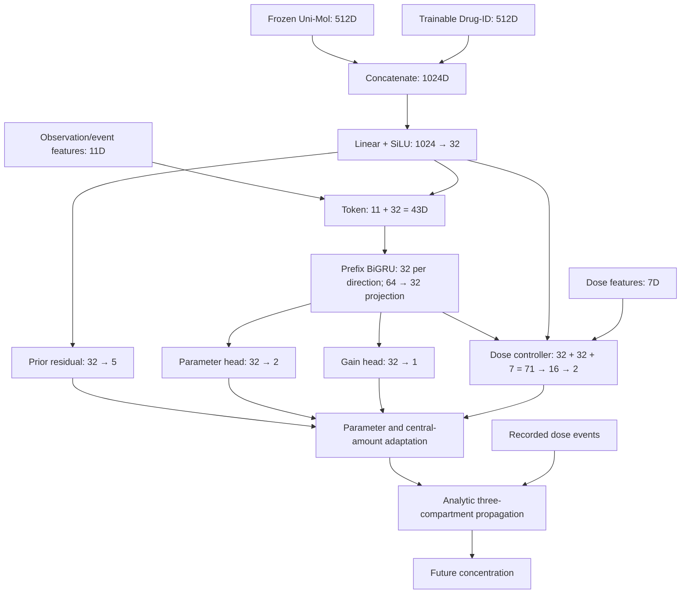

# MoDA-PK: implementation and dimensional flow

This document describes the 11-drug FULL model used in the revised manuscript. It follows the executable implementation rather than a generic neural PK architecture.

## 1. Prediction task

Inputs are a frozen molecular vector, a drug identifier, recorded dosing events, and concentration observations available up to a forecast origin. The model predicts subsequent log concentrations. It has three information levels:

- Drug context establishes an effective drug-specific PK prior.
- Individual observations update clearance, central volume, and central amount.
- Analytic compartment dynamics propagate the state between observations and future queries under the recorded doses.

Drug-ID is not patient ID. Weight, age, sex, and concomitant medications are not direct inputs to the current model. Without concentration observations, individuals with the same drug and dosing record receive the same prior-driven predictions.

## 2. Tensor dimensions

B denotes profiles in a batch, E the maximum number of dosing events, S the maximum number of supplied observation records, and T the maximum number of future query records. A participant may contribute multiple profiles. The history count k refers to distinct observation-time blocks, including all same-time replicates.

| Tensor | Shape |
|---|---|
| Frozen molecular representation z | B × 512 |
| Learned drug-identity representation e | B × 512 |
| Joint representation [z;e] | B × 1024 |
| Drug context c | B × 32 |
| Drug-conditioned log-PK prior μ | B × 5 |
| Observation/event features f at one time | B × 11 |
| Encoder token [f;c] | B × 43 |
| Forward/backward terminal summaries | B × 32 each |
| Projected history summary h | B × 32 |
| Compartment amount state | B × 3 |
| Dosing records | B × E × 4 |
| Future log-concentration predictions | B × T |

Variable-length sequences are padded and masked. The original model uses float64 computation.



## 3. Molecular and identity conditioning

### Frozen molecular input

The 512D Uni-Mol vectors are precomputed and remain frozen during PK fitting. Their standardization uses the unique training-drug vectors, not repeated participant rows:

\[
\widetilde z_{d,j}=\frac{z_{d,j}-m_j}{\max(\sigma_j,0.1)}.
\]

A single-drug model standardizes one molecular vector to zero. Single-drug performance therefore does not establish a contribution from molecular information.

### Trainable drug identity

The integrated lookup table has shape **11 × 512**. Every profile for a given drug uses the same row. The mapping is derived from the training drugs. An unknown identity index of −1 uses the mean training identity vector in the implementation; this fallback is not evidence of unseen-drug predictive performance.

### Joint context

\[
u_d=[\widetilde z_d;e_d]\in\mathbb R^{1024},
\qquad c_d=\operatorname{SiLU}(W_cu_d+b_c)\in\mathbb R^{32}.
\]

This 32D context is shared by prior construction, the observation encoder, and the dose controller. The 512D identity vector is not fed directly into the BiGRU.

## 4. Effective PK prior

A linear residual head produces five values:

\[
v_d=W_vc_d+b_v,\qquad \mu_d=\beta+v_d,
\]

\[
\mu_d=(\log k_a,\log CL,\log V_c,\log Q,\log V_p).
\]

The five-dimensional base β is initialized by training-only population calibration and remains trainable. The residual head is initialized to zero. Exponentiation gives positive kinetic parameters. Standardized units are hours, μmol, and μmol/L; the implied units are h⁻¹ for ka, L/h for CL and Q, and L for Vc and Vp.

The **32D context is a latent representation**, whereas the **5D output parameterizes the effective compartment dynamics**. These effective parameters are not automatically identified physiological quantities.

## 5. Compartments and dosing

The state order is depot, central, peripheral:

\[
A=(A_g,A_c,A_p)^\top.
\]

Between external inputs:

\[
\dot A_g=-k_aA_g,
\]
\[
\dot A_c=k_aA_g-(CL/V_c+Q/V_c)A_c+(Q/V_p)A_p,
\]
\[
\dot A_p=(Q/V_c)A_c-(Q/V_p)A_p.
\]

An event stores `[start_time, amount, route, duration]`. Route codes 0/1/2 denote oral/IV bolus/IV infusion. Oral impulses enter the depot; boluses enter the central compartment; finite infusions provide a constant central rate over their duration.

The solver uses analytic state-transition matrices and infusion responses. It is not a neural network that predicts arbitrary ODE derivatives. An infusion crossing an observation boundary contributes only its remaining portion afterward. The `include_start` flag controls whether a boundary impulse is included, preventing duplicate dose administration.

## 6. Observation features

Before assimilation, the preceding adapted state is propagated to the observation time using the preceding parameters. Its central amount and volume give the pre-update prediction. The FULL path uses:

\[
\widehat y_i^-=\log\max(A_{c,i}^-/V_{c,i-1},10^{-5}).
\]

The active observation link is `relational.floor_concentration`. Other helpers in the source tree may use `log(C+epsilon)`; they should not be substituted silently.

Same-time replicate **log concentrations are averaged**. Exponentiating this average gives the replicate geometric mean for assimilation, not their arithmetic concentration mean.

The 11 features are ordered as follows:

| Index | Feature |
|---:|---|
| 0 | Supplied log concentration |
| 1 | Pre-update predicted log concentration |
| 2 | Innovation: observed minus predicted log concentration |
| 3 | log1p elapsed time since the preceding processing boundary |
| 4 | log1p time since the most recently started dose |
| 5 | log1p cumulative delivered dose amount |
| 6 | log1p active infusion rate |
| 7 | log1p same-time replicate count |
| 8 | Indicator that an oral event has occurred |
| 9 | Indicator that an IV-bolus event has occurred |
| 10 | Indicator that an IV-infusion event has occurred |

For mixed regimens, more than one route flag may be active. Delivered infusion amount accounts for the fraction already delivered. The current FULL `dose_gate` path leaves these 11 features unchanged before concatenating the context; the alternative `dose_film` path is not the FULL architecture.

## 7. Available-prefix BiGRU

At observation i, the encoder processes only tokens 1 through i:

\[
x_i=[f_i;c_d]\in\mathbb R^{43}.
\]

Each direction uses a `GRUCell(43,32)`. Forward and reverse terminal summaries are concatenated and projected:

\[
h_i=W_h[h_i^{\rightarrow};h_i^{\leftarrow}]+b_h\in\mathbb R^{32}.
\]

The projection is **64 → 32**, with no additional activation in that step. Bidirectionality is restricted to the available prefix. Later observations and future query labels are not available to an earlier update. Previously constructed tokens are not recomputed using subsequently observed concentrations. Inactive/padded positions are masked, and token history is reset for each forward call.

## 8. Dose controller

The direct controller input concatenates:

\[
[h_i;c_d;f_i^{\mathrm{dose}}]\in\mathbb R^{32+32+7}=\mathbb R^{71}.
\]

The seven dose coordinates are feature indices **[3,4,5,6,8,9,10]**. Replicate count is not among them. The controller is:

```text
Linear(71,16) -> SiLU -> Linear(16,2)
```

Its outputs a and b adjust the parameter-correction scale and amount-gain logit. The final linear layer is zero-initialized, so the initial parameter scale is neutral and the initial additional gain-logit shift is zero. This is not route-specific expert selection.

## 9. CL/Vc correction

The history head produces two logits:

\[
r_i=W_\delta h_i+b_\delta\in\mathbb R^2,
\qquad s_i=2\sigma(a_i)\in(0,2),
\]
\[
\delta_i=2\tanh(s_ir_i)\in(-2,2)^2,
\]
\[
\theta_i=\mu_d+(0,\delta_{i,CL},\delta_{i,V_c},0,0)^\top.
\]

Corrections are **relative to the drug prior**, not accumulated onto the preceding correction. ka, Q, and Vp retain the drug-prior values during individual observation adaptation. CL and Vc can each change by approximately exp(−2) to exp(2) relative to their prior values. The `Linear(32,2)` head is zero-initialized.

Positivity and bounded offsets are numerical/structural constraints; they do not establish physiological parameter recovery.

## 10. Central-amount correction

The gain is:

\[
g_i=\sigma(W_gh_i+b_g+b_i)\in(0,1).
\]

The **newly updated** central volume converts the supplied concentration to amount:

\[
C_i=\exp(y_i),\quad V_{c,i}=\exp(\theta_{i,V_c}),
\]
\[
A_{c,i}^{+}=(1-g_i)A_{c,i}^{-}+g_iC_iV_{c,i}.
\]

Depot and peripheral amounts retain their propagated values. The gain is an estimator coefficient, not a calibrated uncertainty probability. Assimilation corrects a hidden-state estimate; it is not an additional administered dose or evidence of physiological mass-balance validation across the observation correction.

The gain head is `Linear(32,1)` and is zero-initialized, giving an initial gain of 0.5 under the FULL default that allows initial-time adaptation.

## 11. Exact update order

1. Propagate the previous state to the observation using the previous parameters and recorded doses.
2. Compute the pre-update prediction using the previous central volume.
3. Build the 11D features, including the observed innovation.
4. Concatenate 32D context and encode the available 43D-token prefix.
5. Compute the 71D controller outputs.
6. Compute bounded CL/Vc corrections and the new parameter vector.
7. Compute the amount gain.
8. Convert the observed concentration using the **new** Vc and update central amount.
9. Pass the new parameters, state, and time to the next observation.

Reordering the parameter and amount steps changes the implemented model.

## 12. Forecasting after the last observation

After the final supplied block, the adapted parameters remain fixed. The state is propagated under recorded future dosing:

\[
\widehat A(t)=\operatorname{Advance}(\theta_k,A_k^+,t_k,t,\mathcal D),
\qquad \widehat y(t)=\log\max(\widehat A_c(t)/V_{c,k},10^{-5}).
\]

Output shape is B × T. Query predictions are not fed back as observations. Future observed concentrations are used only for loss/scoring. With k=0, prediction uses the drug prior and doses without observation assimilation. The use of future recorded doses does not establish prospective dose-plan prediction.

## 13. Original loss and evaluation

The weighted data loss is:

\[
\mathcal L_{\mathrm{data}}=\sum_{sdpq}w_{sdpq}(\widehat y_q-y_q)^2,
\qquad w_{sdpq}=\frac1{|S|\,|D_s|\,|P_{sd}|\,|Q_{sdp}|}.
\]

Queries are counted across a participant's repeated profiles. Weighting balances sources, then drugs within source, then participants within drug; it is not exactly equal-drug macro weighting when sources contain different numbers of drugs.

\[
\mathcal L=\mathcal L_{\mathrm{data}}+10^{-3}R_\delta+10^{-4}R_v.
\]

R_delta is the observation-time mean squared CL/Vc correction, aggregated with profile query weights. R_v is the mean squared five-dimensional prior residual. The original objective has no separate amount-gain penalty.

Original fitting uses full-batch AdamW, learning rate 0.003, weight decay 0.0001, 120 updates, gradient clipping at 5, and minimum validation SB-hRMSE selected every ten updates including zero. The original train/validation/test profile split is 285/96/101.

The four support slots correspond to **k=0,1,2,4**, not k=0,1,2,3. Training/validation queries follow the fourth block; validation supplies two blocks. Primary test supplies three blocks and scores all subsequent measurements. The mismatch is an explicit limitation retained across matched variants.

For participant p and drug d, query squared log-errors are averaged first. Drug RMSE is the square root of the mean participant MSE. Overall SB-hRMSE averages drug RMSE within source, then averages sources. Across-seed SD is sample fitting variability, not patient-level confidence.

## 14. Matched ablations

| Variant | Molecular | Drug ID | CL/Vc correction | Amount correction |
|---|---|---|---|---|
| FULL | On | On | On | On |
| NO-UPDATE | On | On | Off | Off |
| PARAM-ONLY | On | On | On | Off |
| AMOUNT-ONLY | On | On | Off | On |
| ID-ONLY | Zero vector | On | On | On |
| MOL-ONLY | On | Zero vector | On | On |

Disabled CL/Vc adaptation fixes parameters to the drug prior at every observation and sets its correction penalty to zero. Disabled amount adaptation sets gain to zero. Prior regularization remains. NO-UPDATE predictions must be invariant to concentration-value perturbations. Conditioning controls retain the 1024D projection shape, although the zeroed input weights are effectively inactive.

Controls were independently trained, rather than created by disabling trained FULL heads at inference. Five FULL checkpoints were reused, and each control was trained for seeds 1–5: 25 fits in total, comprising the original 15 and ten additional fits. Numerical results are in `data/essential/`.

## 15. Parameter count

| Module | Parameters |
|---|---:|
| Drug-ID lookup: 11 × 512 | 5,632 |
| Context projection: 1024 × 32 + 32 | 32,800 |
| Prior residual: 32 × 5 + 5 | 165 |
| Trainable base | 5 |
| Prior subtotal | 38,602 |
| Forward GRUCell | 7,392 |
| Backward GRUCell | 7,392 |
| Bidirectional projection: 64 × 32 + 32 | 2,080 |
| History encoder subtotal | 16,864 |
| Parameter head | 66 |
| Gain head | 33 |
| Dose controller | 1,186 |
| **Total** | **56,751** |

Each additional training drug adds 512 identity parameters. A 12-drug instance therefore has 57,263 parameters. Frozen molecular-encoder weights and the embedding cache are excluded from these counts.

## 16. Optional 64D controller test

A separate five-seed test removed only the seven **direct** dose-feature inputs, changing the controller to **64 → 16 → 2**. The 11D history features remained intact, so dose information could still reach the gate through the history representation. Shared initialization weights were preserved by truncating only the removed first-layer columns.

This removed 112 trainable parameters, giving 56,639 total. Under the same original fitting protocol, SB-hRMSE increased from 0.467 ± 0.011 to 0.496 ± 0.010. The main model retains the 71D controller. Overlap between encoder and controller inputs does not, by itself, prove that the direct path is redundant.

## 17. Implementation map

All paths are relative to this repository's `src/mhap_pk/` directory.

| File | Responsibility |
|---|---|
| `models/adapters/final_gated_bigru.py` | FULL and ablation assembly |
| `models/priors/molecular_identity.py` | 512+512 -> 32 -> 5 prior |
| `models/adapters/bidirectional_observer.py` | Prefix bidirectional encoding |
| `models/adapters/dosing_conditioning.py` | Dose controller and head coupling |
| `relational_model.py` | Observation features and state-update order |
| `relational.py` | Active floor-log concentration link |
| `state_ode.py` | Analytic transitions and dose propagation |
| `../moda_pk.py` | Convenience construction API |
| `../moda_training.py` | Prepared-tensor training loop |

The original workspace's data loaders and source-specific preprocessing are not part of this minimal model dependency snapshot. Prepared training input requirements are documented separately.

## 18. Interpretation boundaries

Drug context is not a demographic patient embedding. A latent embedding is not a physiological PK parameter. Parameter adaptation changes subsequent dynamics, whereas amount adaptation changes the current estimated state. Only CL/Vc and central amount are individualized by these heads; all three compartments are not independently corrected from observations.

Available-prefix bidirectionality does not require future-label access. Positive parameters do not establish identifiability. Seen-drug forecasting does not establish unseen-drug generalization. Finally, accurate integrated forecasts do not establish that adding donor-drug records consistently helps a scarce-data target: the matched low-data effects were heterogeneous.
